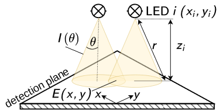

# Direct Irradiation Module Optimization

## Overview




This project belongs to the manuscript "Rapid Design of Homogeneous Direct-LED Irradiation Modules Using a Geometric Radiation Field Model". An earlier version of the manuscript is available as a preprint on Zenodo under the title "Making Photocatalyst Screening Photo-Efficient – Geometric Radiation Field Model Assisted Design of a Direct Irradiation Module for the Multi-Batch Screening Reactor", DOI: [10.5281/zenodo.17867874](https://doi.org/10.5281/zenodo.17867874). The repository contains the Python code used for the simulations and optimizations described in the manuscript as well as the corresponding radiometry and ray-tracing data. The full dataset, including the radiometry raw data and the electronic lab notebook entries of the simulations, is available on Zenodo, DOI: [10.5281/zenodo.18610996](https://doi.org/10.5281/zenodo.18610996).

## Features
- Systematic sampler and Monte-Carlo sampler that generate candidate LED arrangements for the optimization of the direct irradiation module
- Geometric radiation field model
- Optimization routines that find the best trade-offs between mean irradiance and homogeneity
- Evaluation of ray-tracing and radiometry data
- Point-by-point comparison of geometric model, ray tracing and radiometry (residual maps and error statistics)
- Analyses of the Supporting Information: point-source assumption, uncertainties of ray tracing and radiometry, influence of the irradiance bound and convergence of the Monte-Carlo optimization
- Data analysis and visualization: one script generates all figures and tables of the publication

## Repository Structure

| Path | Content |
|---|---|
| `geometric_model.py` | Geometric radiation field model |
| `optimizer.py` | Pareto analysis and selection of the best configuration |
| `utils/` | Grid, LED, systematic sampler and Monte-Carlo sampler |
| `analysis/` | Evaluation of the radiometry and ray-tracing data and the analyses of the Supporting Information |
| `visualization/` | Figures of the publication |
| `results/` | Radiometry, ray-tracing and simulation data |
| `tests/` | Tests of the fast evaluation and of the published Monte-Carlo sample |
| `doc/` | Source of the documentation |
| `usage_example.py` | Example of the complete workflow |
| `create_manuscript_plots_tables.py` | Generates all figures and tables of the publication |

## Installation

To install this project, you need Git and Python 3.12 or newer. Instructions for installing [Git](https://git-scm.com/book/en/v2/Getting-Started-Installing-Git) and [Python with pip](https://realpython.com/installing-python/) are available online. The project was developed and tested with Python 3.13.3 on Windows and Linux.

Follow these steps to set up the project:

1. Open a terminal (Command Prompt on Windows, Terminal on macOS and Linux) in the folder in which you want to store the project.

2. Copy the project to your computer:

	```bash
	git clone https://github.com/photonZfeed/DirectIrradiationModule
	```

3. Move into the project folder:

	```bash
	cd DirectIrradiationModule
	```

4. Create and activate a virtual environment (recommended), on macOS and Linux with

	```bash
	python3 -m venv .venv
	source .venv/bin/activate
	```

	and on Windows with

	```bash
	py -m venv .venv
	.venv\Scripts\activate
	```

5. Install the required Python packages:

	```bash
	pip install -r requirements.txt
	```

## Usage
Run the script `usage_example.py` to see how the modules of this project are used, or run `create_manuscript_plots_tables.py` to generate the figures and tables of the publication and its Supporting Information:

```bash
python usage_example.py
```

or

```bash
python create_manuscript_plots_tables.py
```

`create_manuscript_plots_tables.py --list` lists every figure and table it generates; figures are written to `figures/`, tables to `tables/`. Figure 5, Table S5 and the convergence study of the Monte-Carlo optimization (Figures S18 and S19) need data files that are too large for this repository and are part of the [Zenodo dataset](https://doi.org/10.5281/zenodo.18610996); steps whose data are missing are skipped. The documentation page "[Reproducing the Publication](https://photonzfeed.github.io/DirectIrradiationModule/reproduce.html)" lists the outputs, the functions that produce them and the data they need.

Refer to the [documentation](https://photonzfeed.github.io/DirectIrradiationModule/) and to `usage_example.py` for detailed usage instructions.

## Documentation

The documentation is available at [https://photonzfeed.github.io/DirectIrradiationModule](https://photonzfeed.github.io/DirectIrradiationModule). It describes how to build the direct irradiation module, how to perform the radiometric measurements and the ray-tracing simulations, how to use the optimization code and how to reproduce the figures and tables of the publication, and it gives a detailed overview of the API.

## AI Assistance Disclosure

This repository was developed with the assistance of AI language models. These tools were used to support code development, the creation of the documentation and the identification of code correctness issues. All AI-generated changes were reviewed and approved by the authors before being committed.

The following AI tools were used:

- **Claude Code** (command-line interface by Anthropic), powered by the **Claude Sonnet 4.6** model (Anthropic, PBC).
- **Claude Cowork** (desktop interface by Anthropic), powered by the **Claude Opus 5** and **Claude Opus 5.5** models (Anthropic, PBC).
- **GitHub Copilot** (Visual Studio Code extension by GitHub, Inc.), powered by the **OpenAI GPT-4** model (OpenAI, L.L.C.).
