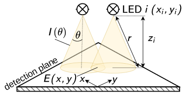

Multi-Batch Screening Reactor - Designing a Direct Irradiation Module Documentation
=====================================================================================

Overview
--------

.. _fig-model-overview:

   Overview of the geometric model for the direct irradiation module design.
   

This project belongs to the article "Rapid Design of Homogeneous Direct-LED Irradiation Modules Using a Geometric Radiation Field Model", *ACS Engineering Au* (DOI: `10.1021/acsengineeringau.6c00051 <https://doi.org/10.1021/acsengineeringau.6c00051>`_). An earlier version of the manuscript is available as a preprint on Zenodo under the title "Making Photocatalyst Screening Photo-Efficient – Geometric Radiation Field Model Assisted Design of a Direct Irradiation Module for the Multi-Batch Screening Reactor" (DOI: `10.5281/zenodo.17867874 <https://doi.org/10.5281/zenodo.17867874>`_).

This documentation provides guides and API references for designing and optimizing the presented direct irradiation module. It covers:

* the required components and the assembly instructions of the direct irradiation module,
* the methodology of the radiometric measurements and the ray-tracing simulations used to validate the geometric model,
* the installation of the code and a tutorial of the optimization workflow,
* the reproduction of all figures and tables of the publication and its Supporting Information,
* the API documentation of the sampling algorithms, the geometric model and the optimization routine used for the module design, of the evaluation of the radiometry and ray-tracing data and of the analyses and figures of the publication.

The Python code, the radiometry data and the ray-tracing simulations are available on `GitHub <https://github.com/photonZfeed/DirectIrradiationModule>`_; the full dataset, including the radiometry raw data and the electronic lab notebook entries of the simulations, is available on Zenodo (DOI: `10.5281/zenodo.18610996 <https://doi.org/10.5281/zenodo.18610996>`_).

.. toctree::
   :maxdepth: 1
   :caption: Contents:
   
   module_assembly
   radiometry
   raytracing
   installation
   tutorial
   reproduce
   api/index